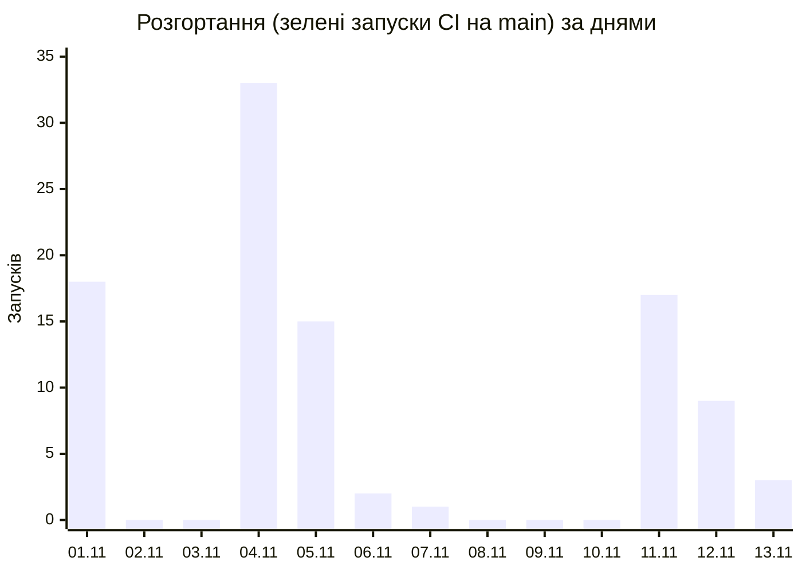
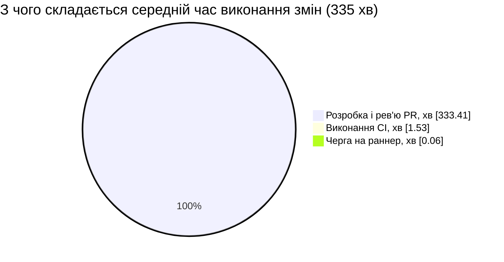

# Звіт DORA: Клініка продуктивності CI/CD (DORA Summary)

Звіт команди **ctrl-alt-defeat** за результатами аналізу історії запусків CI/CD конвеєра в репозиторії [`ukma-fin-ssdm-2026/ctrl-alt-defeat`](https://github.com/ukma-fin-ssdm-2026/ctrl-alt-defeat).

---

## 1. Визначення розгортання та методологія

- **Визначення розгортання (deployment)**: згідно з концепцією безперервної доставки (Continuous Delivery), кожна зелена збірка на гілці `main` вважається готовою до випуску в робоче середовище, отже приймається як розгортання. У цьому звіті показники DORA розраховано як **наближення розгортань на основі телеметрії CI гілки `main`**.
- **Врахований workflow**: конвеєр `CI Test` (`.github/workflows/ci.yml`), який виконує:
  - Модульні та інтеграційні тести бекенду (`pytest`) з перевіркою покриття (`coverage`);
  - Тестування фронтенду (`vitest`);
  - Перевірки якості коду та форматування (`black`, `ruff`);
  - Перевірки надійності та безпеки (`reliability tests`, `secrets leak check`);
  - Збірку Docker образу (`docker build`).
- **Період дослідження**: **01.11.2026 – 13.11.2026** (12.0 днів / 1.71 тижня).
- **Обсяг вибірки**: **98 запусків** на гілці `main`.
- **Первинні дані та докази**:
  - Таблиця первинних запусків: [`docs/ci-cd/metrics-raw.md`](metrics-raw.md)
  - JSON-експорт історії запусків: [`docs/ci-cd/evidence/gh-runs-raw.json`](evidence/gh-runs-raw.json)
  - Прямий вивід CLI: [`docs/ci-cd/evidence/gh-run-list-since-nov01.json`](evidence/gh-run-list-since-nov01.json)

---

## 2. Обчислення чотирьох метрик DORA (Етап 2)

Категорії й частки опитаних взято зі звіту [DORA 2025 «State of AI-assisted Software Development»](https://services.google.com/fh/files/misc/2025_state_of_ai_assisted_software_development.pdf) (рис. 11–14, майже 5 000 опитаних). Наші значення пораховано з історії CI на `main`, а не з розгортань у робоче середовище, тому це наближення до визначень DORA.

| Метрика | Формула | Ваш результат | Категорія (DORA 2025) |
|---|---|:---:|---|
| **Частота розгортань** *(Deployment Frequency)* | Зелені запуски на `main` за період / кількість тижнів | **57.3 на тиждень**<br>(8.2 на день, всього 98 за 12 днів) | **На вимогу (кілька разів на день)**<br>*(такий або кращий результат мають **16,2%** опитаних)* |
| **Час виконання змін** *(Change Lead Time)* | Середнє і медіана інтервалу від першого коміту PR до завершення зеленого запуску на `main` | Медіана: **21.4 хв (0.36 год)**<br>Середнє: **335.0 хв (5.58 год)** | **Менше години** (за медіаною: 21,4 хв)<br>*(такий або кращий результат мають **9,4%** опитаних)* |
| **Частка збоїв змін** *(Change Fail Rate)* | Червоні запуски на `main` / усі завершені запуски на `main` × 100% | **0,0%**<br>(0 червоних з 98 завершених запусків) | **0–2%**<br>*(такий або кращий результат мають **8,5%** опитаних)* |
| **Час відновлення після збою** *(Failed Deployment Recovery Time)* | Середнє і медіана інтервалу від червоного запуску на `main` до наступного зеленого на `main` | **Немає даних** *(червоних запусків на `main` не було, тож відновлювати не було чого)*<br>Дефекти зупинялися на етапі PR | **—**<br>*(без збоїв рівень визначити не можна)* |

---

## 3. Порівняння з орієнтирами телеметрії CircleCI (2025 / 2026)

Згідно зі звітами CircleCI *State of Software Delivery* [2025](https://circleci.com/landing-pages/assets/2025-state-of-software-delivery-report.pdf) і [2026](https://circleci.com/landing-pages/assets/2026-state-of-software-delivery-report.pdf) (на основі мільйонів реальних запусків конвеєрів), ефективність конвеєра команди ctrl-alt-defeat зіставляється наступним чином:

| Показник | Рекомендований орієнтир CircleCI | Фактичне значення в індустрії (2025) | Фактичне значення нашої команди | Оцінка |
|---|:---:|:---:|:---:|:---:|
| **Частка успішних запусків на основній гілці** | **90%** | 70,8% | **100,0%** (98 з 98) | **Перевищує орієнтир** (завдяки жорстким PR status checks) |
| **Повернення основної гілки до зеленого стану** | **до 60 хв** | 59,2 хв (медіана) | **немає даних** (гілка main жодного разу не ламалася) | **Відмінно** (дефекти відсіюються до злиття) |
| **Тривалість запуску workflow (Execution duration)** | **до 10 хв** | 2,2 хв (медіана) | **1,50 хв** (медіана)<br>*(1,53 хв середнє)* | **Виняткова швидкість** (швидше за індустріальну медіану 2025 р.) |

---

## 4. Декомпозиція часу виконання змін (Lead Time Breakdown)

Час виконання змін (Change Lead Time) вимірює повний шлях зміни від моменту першого авторського коміту в гілці Pull Request до успішного проходження CI після злиття в `main`.

Ми розділили час на 3 складові:
1. **Час очікування в черзі (Queue time)** — від створення запуску в GitHub Actions до виділення вільного раннера.
2. **Час виконання конвеєра (Execution time)** — безпосередня робота кроків тестування та збірки.
3. **Час циклу розробки та рев'ю (PR Lifecycle & Review stage)** — час написання коду, відкриття PR, очікування перевірки колегами та злиття.

### Розрахунок часток:

| Складова | Медіанне значення | Частка від медіани Lead Time (21,4 хв) | Середнє значення | Частка від середнього Lead Time (335,0 хв) |
|---|:---:|:---:|:---:|:---:|
| **Час у черзі (Queue Time)** | **0,00 хв** (< 6 сек) | **0,00%** | **0,06 хв** (3,6 сек) | **0,02%** |
| **Час виконання CI (Execution Time)** | **1,50 хв** | **7,01%** | **1,53 хв** | **0,46%** |
| **Розробка та перевірка PR (PR Review / Dev)** | **19,90 хв** | **92,99%** | **333,41 хв** (5,55 год) | **99,52%** |
| **Разом (Change Lead Time)** | **21,40 хв** | **100,0%** | **335,04 хв** | **100,0%** |

### Ключові інсайти декомпозиції:
1. **Черга НЕ є вузьким місцем (bottleneck)**: оскільки використовується хмарний пул `runs-on: ubuntu-latest`, запуски стартують миттєво. Навіть 1 листопада перед дедлайном максимальне очікування склало лише 0,9 хв (54 сек).
2. **Конвеєр працює надзвичайно швидко**: 1,5 хвилини виконання займають лише 7% медіанного часу доставки.
3. **Основний час зосереджений у людському факторі (PR Review Stage)**: понад 92% часу займає цикл очікування рев'ю або доопрацювання коду розробником перед злиттям. При цьому 78,6% усіх змін вливаються менше ніж за 1 годину від старту розробки.

---

## 5. Аналіз метрик парами (Швидкість і Стабільність)

- **Пара швидкості**: *Deployment Frequency* (8.2 розгортань/день) + *Change Lead Time* (медіана 21,4 хв).
  - Команда демонструє високу частоту та швидкість доставки невеликих інкрементів коду без накопичення гігантських PR.
- **Пара стабільності**: *Change Fail Rate* (0,0%) + *Recovery Time* (немає даних: збоїв не було).
  - Досягнуто нульового рівня збоїв на `main` завдяки обов'язковому правилу проходження CI тестів у PR гілках перед кнопкою «Merge».
- **Взаємний вплив (Trade-off)**:
  - Часто підвищення швидкості призводить до зростання кількості помилок. У нашому випадку висока швидкість поєднується зі 100% надійністю на основній гілці, оскільки «ціна перевірки» винесена у швидкий 1,5-хвилинний PR check, який не блокує команду.

---

## 6. План покращень (Improvement Backlog — Етап 3)

| Метрика | Проблема | Першопричина | Дія | Відповідальний |
|---|---|---|---|:---:|
| **Час виконання змін** *(Change Lead Time)* | Довгий «хвіст» очікування в окремих PR (середнє 5.58 год проти медіани 21.4 хв, макс. до 10 год у нічних PR) | Асинхронне код-рев'ю без фіксованого терміну; відкриття PR пізно ввечері, які переглядаються лише наступного дня | Впровадити правило Review SLA: первинний огляд PR до 3 годин у робочий час; розділяти великі фічі на невеликі PR (< 200 рядків) | `@Lifencev` |
| **Час виконання змін** *(Change Lead Time)* | Запуск повного набору тестів на кожен коміт у PR, навіть для суто документаційних правок | Відсутність селективної фільтрації зачіплених файлів у конвеєрі `ci.yml` | Налаштувати фільтрацію `paths-ignore` (`docs/**`, `*.md`), запускаючи лише швидкі перевірки форматування для документації | `@Lifencev` |
| **Частота розгортань** *(Deployment Frequency)* | Нерівномірність релізів: сплески перед дедлайнами (18 запусків 01.11, 33 запуски 04.11) та дні без злиття | Накопичення коду в локальних гілках замість щоденного злиття невеликих інкрементів | Застосовувати практику Trunk-Based Development: зливати перевірений код у `main` щодня під Feature Flags або за драфт-інтерфейсами | `@krylov-mykhailo` |
| **Частота розгортань** *(Deployment Frequency)* | Оновлення залежностей від Dependabot приходять окремими PR і зливаються пачками, кожен PR займає раннер на повний CI | Dependabot налаштовано на окремий PR для кожного пакета | Групувати оновлення Dependabot (`groups` у `.github/dependabot.yml`) в один PR на тиждень для pip і npm *(впроваджено, див. нижче)* | `@krylov-mykhailo` |
| **Час виконання змін** *(Change Lead Time)* | Виконання CI на `main` зросло до ~3 хв; крок тестів бекенду займає ~3 хв із них | Кожен тест хешує й перевіряє паролі bcrypt з вартістю 12, як у продакшні | У тестах знизити вартість bcrypt до мінімальної (4) через змінну середовища `BCRYPT_ROUNDS`; продакшн без змін *(впроваджено в [#258](https://github.com/ukma-fin-ssdm-2026/ctrl-alt-defeat/pull/258), див. «Бонуси»)* | `@krylov-mykhailo` |
| **Частка збоїв змін** *(Change Fail Rate)* | Ризик пропуску дефектів, пов'язаних із нестабільністю зовнішніх сервісів (TMDB, Render) | Тести використовують живі таймаути або недостатньо ізольовані моки зовнішнього API | Додати до тестів надійності тестові дублери з контрольованим введенням збоїв (latency injection, error codes) | `@YuliiaHalka` |
| **Час відновлення після збою** *(Recovery Time)* | Відсутність автоматизованого відкату сервісу на Render у разі збою після розгортання | Відновлення здійснюється лише ручним комітом або створенням нового хотфіксу | Додати в `production-deployment.yml` крок автоматичного відкату (Rollback via Render Deploy Hook) на попередній стабільний коміт у разі збою liveness check | `@YuliiaHalka` |

---

### Уже впроваджено

| Метрика | Що було | Що зроблено | Коли |
|---|---|---|---|
| **Частота розгортань** *(Deployment Frequency)* | Версії в `pyproject.toml`, `package.json`, `CHANGELOG.md` і релізний тег готувалися вручну | Workflow [`release.yml`](../../.github/workflows/release.yml) сам створює тег і GitHub Release, коли в `main` потрапляє нова версія в `CHANGELOG.md`; так вийшли релізи [v1.0.0–v1.1.0](https://github.com/ukma-fin-ssdm-2026/ctrl-alt-defeat/releases) | 12–14.11.2026 |
| **Час виконання змін** *(Change Lead Time)* | Кожен тест хешував паролі bcrypt з вартістю 12; крок тестів бекенду в CI займав до 185 с | Тести використовують вартість 4 (`BCRYPT_ROUNDS`), продакшн — 12; [#258](https://github.com/ukma-fin-ssdm-2026/ctrl-alt-defeat/pull/258), ефект — у розділі «Бонуси» | 18.11.2026 |
| **Частота розгортань** *(Deployment Frequency)* | Dependabot відкривав окремий PR на кожен пакет: 18.11 за пів години злито шість таких PR, кожен з повним CI | Мінорні й патч-оновлення pip, npm і GitHub Actions групуються в один PR на екосистему щотижня (`.github/dependabot.yml`) | 18.11.2026 |
| **Час відновлення** *(Recovery Time)* / **Частота розгортань** | Релізні контейнери не зберігалися; розгортання та відкат вимагали повторної збірки коду | Workflow [`publish-container.yml`](../../.github/workflows/publish-container.yml) автоматично збирає та публікує перевірений Docker-образ у `ghcr.io` за тегом SHA коміту після кожного зеленого запуску на `main`; [#267](https://github.com/ukma-fin-ssdm-2026/ctrl-alt-defeat/pull/267), див. «Бонуси» | 19.11.2026 |

---

## 7. Дашборд DORA (Етап 4)

Період 01–13.11.2026, 98 запусків `CI Test` на `main`; значення — наближення за історією CI (розділ 1).

| Метрика | Результат | Рівень DORA 2025 | Опитаних з таким або кращим |
|---|---|---|---|
| Частота розгортань | 57,3 на тиждень (8,2 на день) | на вимогу (кілька разів на день) | 16,2% |
| Час виконання змін | медіана 21,4 хв, середнє 5,6 год | менше години | 9,4% |
| Частка збоїв змін | 0% (0 з 98) | 0–2% | 8,5% |
| Час відновлення | немає даних (збоїв на `main` не було) | — | — |





**Ключовий висновок.** Ми зливаємо в `main` кілька разів на день і `main` жодного разу не ламалася, але зливаємо хвилями перед дедлайнами (51 з 98 запусків припали на 01.11 і 04.11, а 02–03.11 і 08–10.11 злиттів не було). Черга й CI займають менше 0,5% часу виконання змін: майже весь час зміна чекає в pull request.

**Дія на наступний тиждень.** Зливати невеликі PR щодня, а не перед дедлайном, і переглядати PR протягом 3 годин у робочий час (Review SLA з плану покращень, відповідальний `@Lifencev`).

---

## 8. Який біль у нашій команді показали ці метрики?

**Код лежить до дедлайну.** Частота розгортань висока в середньому, але нерівномірна: 18 запусків 01.11 і 33 запуски 04.11, а потім п'ять днів без жодного злиття. Зміни накопичуються в гілках і зливаються пачкою перед здачею лабораторної, тож написаний код днями не потрапляє в `main` і не дає користі.

**PR чекають на рев'ю.** Медіана часу виконання змін — 21 хв, але середнє — 5,6 год: 21 з 98 змін ішли довше години, 7 — довше доби, а найдовший PR [#205](https://github.com/ukma-fin-ssdm-2026/ctrl-alt-defeat/pull/205) — майже 5 днів (06.11–11.11). PR, відкриті пізно ввечері 01.11 (#149, #152, #153), злиті лише 04.11. Черга на раннер і CI тут ні до чого (менше 0,5% часу), тобто біль організаційний: немає домовленості, хто і як швидко переглядає PR.

**Зламаної `main` немає — дефекти зупиняються в PR.** За період жоден запуск на `main` не впав, бо злиття можливе лише після зелених обов'язкових перевірок. Ціна цього — червоні запуски в PR: 19 з 224 (8,5%). Команда довіряє `main` і не боїться зливати, але кожен такий збій означає ще одне коло правок і рев'ю.

**Зворотний зв'язок повільнішав непомітно.** Виконання CI на `main` зросло з 1,5 хв на початку листопада до ~3,3 хв 18.11, бо тестів стало більше, а кожен тест дорого хешував паролі. Метрика за період цього не показала; ми помітили це, коли рахували бонус, і виправили в [#258](https://github.com/ukma-fin-ssdm-2026/ctrl-alt-defeat/pull/258).

**Відновлення після невдалого розгортання — ручне.** На `main` збоїв не було, але справжній деплой на Render (`Production deployment`) один раз упав — 05.11 після PR #198 — і повернувся до робочого стану через 19 хв новим комітом. Автоматичного відкату немає, тому відновлення залежить від того, чи хтось зараз дивиться на конвеєр.

**Робота розподілена нерівномірно.** З 80 PR від учасників, злитих за період, 63 (79%) відкрив один учасник, ще 23 PR — Dependabot. Рев'ю і злиття залежать від кількох людей, і коли вони зайняті, PR чекають довше.

---

## Джерела

- DORA, Google Cloud. [State of AI-assisted Software Development 2025](https://services.google.com/fh/files/misc/2025_state_of_ai_assisted_software_development.pdf) ([сторінка звіту](https://research.google/pubs/dora-2025-state-of-ai-assisted-software-development-report/)) — рівні метрик і частки опитаних (рис. 11–14).
- CircleCI. [The 2025 State of Software Delivery](https://circleci.com/landing-pages/assets/2025-state-of-software-delivery-report.pdf) — орієнтири частки успішних запусків, повернення до зеленого стану і тривалості workflow.
- CircleCI. [The 2026 State of Software Delivery](https://circleci.com/landing-pages/assets/2026-state-of-software-delivery-report.pdf).

---

## Бонуси

Докази для бонусів зібрано тут. Кожен бонус пояснює у своєму відео хоча б один учасник команди.

### Бонус 1. Автоматичний підрахунок метрик

PR: [#257](https://github.com/ukma-fin-ssdm-2026/ctrl-alt-defeat/pull/257).

Скрипт [`scripts/dora_metrics.py`](../../scripts/dora_metrics.py) бере історію запусків з GitHub Actions REST API і рахує чотири метрики за визначеннями лабораторної (розділ 1 цього звіту): зелений запуск `CI Test` після push у `main` — розгортання, червоний — невдала зміна, час виконання змін — від першого коміту злитого PR до завершення зеленого запуску з цим комітом, черга й виконання окремо. Скрипт запускається вручну, без розкладу, і лише читає API.

#### Як запустити

```bash
GH_TOKEN=$(gh auth token) python scripts/dora_metrics.py --since 2026-11-01 --until 2026-11-13
```

Період задається днями UTC, обидва кінці включно; без `--until` рахується до сьогодні. Скрипт записує два файли:

- [`dora-auto.md`](dora-auto.md) — метрики з рівнями DORA 2025, частки черги й виконання, орієнтири CircleCI, таблиці запусків, змін і збоїв;
- [`evidence/dora-auto.json`](evidence/dora-auto.json) — кожен запуск і кожна зміна, з яких пораховано метрики.

Як працює підрахунок:

1. Запуски `ci.yml` на `main` з подією `push` за період (`/actions/workflows/ci.yml/runs`), для кожного — його завдання (`/actions/runs/{id}/jobs`): черга — від `created_at` запуску до `started_at` першого завдання, виконання — від нього до `completed_at` останнього.
2. Для кожного зеленого запуску — коміти після попереднього зеленого (`/compare/{попередній}...{цей}`); так зміна з червоного запуску зараховується зеленому, який її доставив.
3. Для кожного коміту — злитий PR (`/commits/{sha}/pulls`) і найраніший коміт цього PR (`/pulls/{n}/commits`); для коміту прямо в `main` відлік іде від самого коміту. Один PR рахується один раз.
4. Серія червоних запусків поспіль — один збій; відновлення — від завершення першого червоного до завершення наступного зеленого.

Тести скрипта: [`tests/test_dora_metrics.py`](../../tests/test_dora_metrics.py) (фіктивна історія з двома червоними запусками поспіль, повторною спробою і комітом напряму в `main`).

#### Результат і розбіжності з ручним підрахунком (Етап 2)

Період той самий, що в ручному підрахунку: 01.11–13.11.2026.

| Показник | Вручну (Етап 2) | Скрипт | Чому відрізняється |
|---|---|---|---|
| Запусків на `main` | 98 | 101 | Ручний експорт зроблено 13.11 близько 10:20 UTC; три запуски того ж вечора (43503853334, 43506666841, 43515082342) у нього не потрапили |
| Тривалість періоду | 12,0 дня (1,71 тиж.) | 13 днів (1,86 тиж.) | Вручну — від першого до останнього запуску, скрипт — повні календарні дні періоду |
| Частота розгортань | 57,3 на тиждень | 54,4 на тиждень | Інший знаменник (див. рядок вище) і +3 запуски; рівень той самий — «на вимогу», 16,2% опитаних |
| Змін (PR або комітів) | 98 (одна на запуск) | 112 | Два push принесли кілька комітів: 01.11 (запуск 41312694535) — PR #125 і 6 комітів напряму в `main`, 04.11 (41862071221) — PR #171 і 5 комітів. Вручну враховано лише PR останнього коміту, скрипт рахує кожну зміну окремо, як вимагає визначення |
| Час виконання змін, медіана | 21,4 хв | 22,5 хв | Інший набір змін (два рядки вище) |
| Час виконання змін, середнє | 335,0 хв | 330,6 хв | Те саме |
| Черга / виконання в часі змін | 0,02% / 0,46% | 0,02% / 0,45% | Майже збігається; решта (розробка і рев'ю PR) — 99,5% |
| Тривалість workflow, медіана | 1,50 хв | 1,52 хв | Три вечірні запуски 13.11 тривали 1,9–3,1 хв |
| Частка збоїв змін | 0% | 0% | Збігається: червоних запусків на `main` не було |
| Час відновлення | — | — | Збоїв не було |

Висновки не змінюються: доставка «на вимогу», медіана часу виконання змін менше години, черги на раннер практично немає, а майже весь час зміни проводять у розробці й рев'ю PR.

### Бонус 2. Покращення з виміряним ефектом: вартість bcrypt у тестах

PR: [#258](https://github.com/ukma-fin-ssdm-2026/ctrl-alt-defeat/pull/258), злито 18.11.2026.

**Метрика:** час виконання змін (change lead time), його складова — виконання CI на `main`; заодно тривалість workflow з орієнтирів CircleCI.

**Проблема.** На 18.11.2026 виконання `CI Test` на `main` зросло до ~3,3 хв (медіана п'яти запусків нижче), а на початку листопада було 1,5 хв. Найдовше працює завдання `build`, і майже весь його час (до 185 с) займає один крок — тести бекенду з покриттям.

**Першопричина.** Паролі хешуються bcrypt з вартістю 12 (2^12 ітерацій), як і має бути в продакшні. Але тести роблять це сотні разів: кожна реєстрація, вхід, зміна пароля і кожен тестовий користувач. Тести перевіряють логіку, а не стійкість хешу до перебору, тож дорога вартість їм не потрібна.

**Дія.** Вартість bcrypt тепер задається змінною `BCRYPT_ROUNDS` (за замовчуванням 12, допустимо 4–16; значення поза межами ігнорується). `tests/conftest.py` ставить для тестів 4. Продакшн не змінився. Хеш зберігає свою вартість, тому паролі, захешовані з вартістю 12, і далі перевіряються — це покриває тест `test_bcrypt_cost_is_configurable_and_any_cost_verifies`.

#### Локальний вимір (той самий набір тестів, MacBook)

| Набір | До | Після |
|---|---|---|
| `tests/test_[a-l]*.py` (197 тестів) | 60,3 с | 12,9 с |
| `tests/test_[m-z]*.py` і `tests/reliability` (329 тестів) | 58,7 с | 17,2 с |
| Разом | 119,0 с | 30,1 с (у 4 рази швидше) |

#### До і після на `main`

Запуски `CI Test` на `main` від злитих PR зі змінами в коді або конфігурації. «Виконання» — від початку першого завдання до кінця останнього, «Тести» — крок `Run Unit Tests with Coverage Gate` завдання `build`.

**До** (останні п'ять запусків перед злиттям цього PR):

| Запуск | PR | Виконання, хв | `build`, хв | Тести, с |
|---|---|---|---|---|
| [44310523529](https://github.com/ukma-fin-ssdm-2026/ctrl-alt-defeat/actions/runs/44310523529) | bump eslint-plugin-react-refresh | 3,50 | 3,48 | 185 |
| [44311230943](https://github.com/ukma-fin-ssdm-2026/ctrl-alt-defeat/actions/runs/44311230943) | #253 bump coverage | 2,57 | 2,57 | 139 |
| [44312099619](https://github.com/ukma-fin-ssdm-2026/ctrl-alt-defeat/actions/runs/44312099619) | bump postcss | 2,68 | 2,68 | 147 |
| [44312752823](https://github.com/ukma-fin-ssdm-2026/ctrl-alt-defeat/actions/runs/44312752823) | #255 bump fastapi | 7,45 | 3,37 | 184 |
| [44313557118](https://github.com/ukma-fin-ssdm-2026/ctrl-alt-defeat/actions/runs/44313557118) | #256 bump @vitejs/plugin-react | 3,32 | 3,32 | 183 |
| **Медіана** | | **3,32** | **3,32** | **183** |

У запуску 44312752823 виконання 7,45 хв, бо частина завдань чекала на вільний раннер; тому порівнюємо також `build` і крок тестів, де черги немає.

**Після** (запуски на `main` після злиття PR #258; враховано лише PR зі змінами в коді, тестах або конфігурації):

| Запуск | PR | Що змінено | Виконання, хв | `build`, хв | Тести, с |
|---|---|---|---|---|---|
| [44326182944](https://github.com/ukma-fin-ssdm-2026/ctrl-alt-defeat/actions/runs/44326182944) | [#258](https://github.com/ukma-fin-ssdm-2026/ctrl-alt-defeat/pull/258) | код і тести (це покращення) | 2,18 | 2,17 | 110 |
| [44328205308](https://github.com/ukma-fin-ssdm-2026/ctrl-alt-defeat/actions/runs/44328205308) | [#259](https://github.com/ukma-fin-ssdm-2026/ctrl-alt-defeat/pull/259) | `tests/conftest.py`, звіт | 1,90 | 1,88 | 89 |
| [44335381055](https://github.com/ukma-fin-ssdm-2026/ctrl-alt-defeat/actions/runs/44335381055) | [#261](https://github.com/ukma-fin-ssdm-2026/ctrl-alt-defeat/pull/261) | `.github/dependabot.yml`, звіт | 1,87 | 1,87 | 95 |
| **Медіана** | | | **1,90** | **1,88** | **95** |

Запуск після [#260](https://github.com/ukma-fin-ssdm-2026/ctrl-alt-defeat/pull/260) (лише документація) не враховано.

**Ефект:**

| Показник (медіана) | До | Після | Зміна |
|---|---|---|---|
| Крок тестів бекенду | 183 с | 95 с | −48% |
| Завдання `build` | 3,32 хв | 1,88 хв | −43% |
| Виконання `CI Test` на `main` | 3,32 хв | 1,90 хв | −43% |

Виконання CI — складова часу виконання змін, тож кожна зміна доходить до `main` приблизно на 1,4 хв швидше, а спільні раннери звільняються раніше. У CI прискорення менше, ніж локально (у 4 рази), бо крок ще й рахує покриття коду.

### Бонус 3. Розділення тестів на швидкий і повільний набори

PR: [#265](https://github.com/ukma-fin-ssdm-2026/ctrl-alt-defeat/pull/265) (розділення наборів); інтеграційні тести на PostgreSQL додано окремим PR.

**Метрика:** час виконання змін (Change Lead Time) — зворотний зв'язок у PR без повільних перевірок.

**Проблема.** Усі тести бекенду, і швидкі модульні, і повільні сценарні, запускалися на кожному PR. Справжньої бази даних не перевіряв жоден тест: усі працювали з SQLite у пам'яті, хоча в продакшні — PostgreSQL (Neon) з іншими типами (UUID, JSON), індексами й обмеженнями.

**Дія.** Тести поділено на два набори маркером `slow` (оголошено в `pyproject.toml`):

- **Швидкий набір** — усе, крім `slow`; запускається на кожному PR у завданні `build` разом з порогом покриття 80%: `pytest -m "not slow" --cov=src.api --cov-fail-under=80 tests/`.
- **Повільний набір** — `pytest -m slow tests/`; завдання `slow` у `ci.yml` запускається лише після злиття в `main`. До нього входять:
    - інтеграційні тести зі справжньою PostgreSQL 16 у сервісному контейнері (`services: postgres` у завданні `slow`) — [`tests/integration/test_postgres_flow.py`](../../tests/integration/test_postgres_flow.py): застосунок стартує як у продакшні (створення схеми, оновлення, сіди) на PostgreSQL, перевіряються таблиці, нативний тип UUID і унікальний індекс `ix_users_email_canonical`, а користувач по HTTP проходить реєстрацію, підтвердження пошти, вхід, «До перегляду», «Переглянуте», рецензію і рекомендації; повторне додавання і друга рецензія впираються в обмеження PostgreSQL і повертають 409, а не 500;
    - сценарії списку «До перегляду» з [`tests/test_watchlist.py`](../../tests/test_watchlist.py) (16 тестів).

Без PostgreSQL у `DATABASE_URL` інтеграційні тести пропускаються, тож локальний запуск усіх тестів не змінився.

#### Як запустити

```bash
# швидкий набір
python -m pytest -m "not slow" --cov=src.api --cov-report=term --cov-fail-under=80 tests/

# повільний набір (потрібна PostgreSQL, наприклад docker run -p 5432:5432 -e POSTGRES_HOST_AUTH_METHOD=trust -e POSTGRES_DB=ci postgres:16)
DATABASE_URL=postgresql://postgres@localhost:5432/ci python -m pytest -m slow -v tests/
```

#### Локальні результати (PostgreSQL 16)

| Набір | Тестів | Час pytest |
|---|---|---|
| Швидкий (`-m "not slow"`, з покриттям 97,74%) | 521 | 51 с |
| Повільний (`-m slow`, PostgreSQL 16) | 19 (3 інтеграційні + 16 сценаріїв watchlist) | 3,1 с |

#### Запуски в GitHub Actions

| Запуск | Що виконано | Тривалість наборів |
|---|---|---|
| _PR з інтеграційними тестами — лише швидкий набір (завдання `slow` пропущено)_ | заповнити після запуску | |
| _`main` після злиття цього PR — обидва набори_ | заповнити після злиття | |

### Бонус 4. Автоматичне виявлення нестабільних тестів (Flaky Tests Detection)

PR: [#265](https://github.com/ukma-fin-ssdm-2026/ctrl-alt-defeat/pull/265).

**Метрика:** частка збоїв змін (Change Fail Rate) та час виконання змін (Change Lead Time).

**Проблема.** Іноді автоматизовані тести можуть завершуватися помилкою без змін у коді. Такі тести називаються *flaky tests*. Вони знижують довіру до CI, змушують повторно запускати перевірки та збільшують час очікування перед злиттям PR.

**Дія.** Реалізовано автоматичну перевірку стабільності тестів за допомогою п'яти послідовних запусків повного набору.

Для кожного запуску зберігаються:

- XML-звіт у форматі JUnit;
- лог виконання pytest;
- код завершення процесу.

На основі отриманих результатів формується звіт `flaky-results/report.md`, який показує тести з різними результатами між запусками.

#### Як запустити

Для локальної перевірки виконуються п'ять послідовних запусків:

```bash
mkdir -p flaky-results

for i in {1..5}; do
    echo "===== Test run $i ====="
    python -m pytest tests/ -q \
        --junitxml="flaky-results/run-$i.xml" \
        > "flaky-results/run-$i.log" 2>&1
    echo "Exit code: $?"
done
```

Після аналізу результатів формується звіт:

```text
flaky-results/report.md
```

#### Початкові результати

Під час першої перевірки отримано такі результати:

| Запуск | Код завершення |
|---|---|
| Run 1 | 0 |
| Run 2 | 1 |
| Run 3 | 0 |
| Run 4 | 0 |
| Run 5 | 0 |

Один із п'яти запусків завершився помилкою.

Початковий звіт показав 21 потенційно нестабільний тест. Однак після аналізу з'ясувалося, що 20 випадків пов'язані з параметризованими тестами `test_password_check.py`.

У цих тестах використовувалися випадково згенеровані bcrypt-хеші. Через це назви тестових випадків відрізнялися між запусками, і система аналізу помилково вважала їх різними тестами.

Реально нестабільним виявився один тест:

```text
tests/reliability/test_startup_without_tmdb.py::test_startup_does_not_wait_for_a_hanging_tmdb
```

#### Аналіз причини нестабільності

Тест перевіряє, що застосунок може запускатися, навіть якщо зовнішній сервіс TMDB не відповідає.

Під час тестування імітується `TimeoutError`, після чого перевіряється завершення фонового оновлення каталогу.

В одному із запусків тест завершився помилкою:

```text
AssertionError: the background catalog update did not finish
```

У логах водночас було зафіксовано очікувану помилку зовнішнього API:

```text
TMDB catalog sync failed: TMDB list request failed: TMDB timed out
```

Проблема була пов'язана з нестабільною взаємодією фонового завдання та тестової SQLite-бази даних. Тест використовував базу в оперативній пам'яті, доступ до якої здійснювався з різних потоків.

#### Виправлення

Для усунення нестабільності було:

1. Стабілізовано роботу тестової бази SQLite під час виконання фонового завдання.
2. Забезпечено коректну ізоляцію тестового середовища.
3. Стабілізовано ідентифікатори параметризованих тестів, щоб вони не змінювалися між запусками.
4. Повторено перевірку всього набору тестів п'ять разів.

#### Результати після виправлення

Після внесення змін повторна перевірка завершилася успішно.

Підсумковий звіт:

```text
# Flaky Tests Report

Runs: 5
Total tests: 536
Flaky tests: 0

No flaky tests detected.
```

| Показник | До виправлення | Після виправлення |
|---|---|---|
| Кількість запусків | 5 | 5 |
| Невдалі запуски | 1 | 0 |
| Потенційно нестабільні тести | 21 | 0 |
| Підтверджені flaky tests | 1 | 0 |
| Результат | Нестабільний | Стабільний |

#### Автоматизація в GitHub Actions

Для регулярної перевірки створено окремий workflow `Flaky Tests Detection`, який можна запускати вручну через GitHub Actions.

Workflow виконує п'ять послідовних запусків тестів, аналізує результати та зберігає сформований звіт як artifact.

Підтвердження: [Flaky Tests Detection #1](https://github.com/ukma-fin-ssdm-2026/ctrl-alt-defeat/actions/workflows/flaky-tests.yml).

Перший запуск workflow завершився успішно:

- **Статус:** Success.
- **Тривалість:** 2 хв 53 с.
- **Кількість artifacts:** 1.

**Ефект.** Реалізовано автоматизований механізм виявлення нестабільних тестів, який дозволяє відокремлювати випадкові збої від реальних регресій.

Після виправлень усі 536 тестів демонструють стабільні результати протягом п'яти послідовних запусків. Це підвищує надійність CI/CD-конвеєра, зменшує ризик зайвих повторних перевірок і допомагає підтримувати стабільність основної гілки `main`.

### Бонус 5. Артефакт випуску з кожного зеленого запуску на main

Після кожного зеленого запуску `CI Test` на `main` workflow [`.github/workflows/publish-container.yml`](../../.github/workflows/publish-container.yml) збирає образ контейнера застосунку і публікує його в GitHub Container Registry (`ghcr.io`) з тегом, що дорівнює SHA коміту (для входу в реєстр використовується `GITHUB_TOKEN` з дозволом `packages: write`). Також доступний ручний запуск (`workflow_dispatch`).

- **Посилання на запуск workflow:** [Publish Container Image Runs](https://github.com/ukma-fin-ssdm-2026/ctrl-alt-defeat/actions/workflows/publish-container.yml)
- **Посилання на сторінку пакета в репозиторії:** [ghcr.io/ukma-fin-ssdm-2026/ctrl-alt-defeat](https://github.com/ukma-fin-ssdm-2026/ctrl-alt-defeat/pkgs/container/ctrl-alt-defeat)

#### Метрики DORA: порівняння визначень розгортання

| Метрика | Варіант 1: Зелений запуск CI на `main` (базовий) | Варіант 2: Публікація образу в GHCR (Бонус 5) | Різниця та категорія DORA 2025 |
|---|:---:|:---:|---|
| **Частота розгортань** *(Deployment Frequency)* | **57,3 на тиждень**<br>(8,2 на день, 98 за 12 днів) | **57,3 на тиждень**<br>(8,2 на день, 98 образів) | Без змін: категорія **«на вимогу»** (16,2% опитаних) |
| **Час виконання змін** *(Change Lead Time)* | Медіана: **21,4 хв**<br>Середнє: **335,0 хв** | Медіана: **22,7 хв**<br>Середнє: **336,4 хв** | +1,3 хв (час збірки та публікації образу ~78 с); категорія **«менше години»** (9,4% опитаних) |
| **Частка збоїв змін** *(Change Fail Rate)* | **0,0%** (0 з 98) | **0,0%** (0 з 98) | Без змін: категорія **0–2%** (8,5% опитаних) |
| **Час відновлення після збою** *(Recovery Time)* | **немає даних** (збоїв не було) | **немає даних** (збоїв не було) | Без змін: без збоїв рівень визначити не можна |

Варіант 2 за 01–13.11 — оцінка, а не вимір: публікація образу почалася лише 19.11. Перший реальний запуск публікації ([44506369182](https://github.com/ukma-fin-ssdm-2026/ctrl-alt-defeat/actions/runs/44506369182)) завершився приблизно через 34 с після зеленого CI, тож фактична добавка до часу виконання змін — близько 0,6 хв. Тег образу береться з `github.event.workflow_run.head_sha`, тому опублікований образ завжди відповідає перевіреному коміту.
