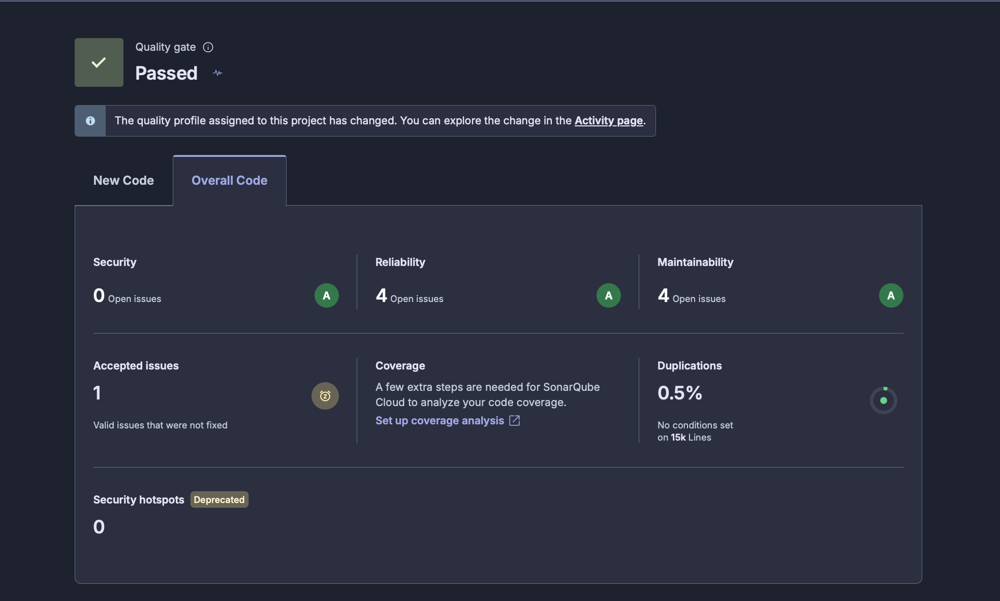
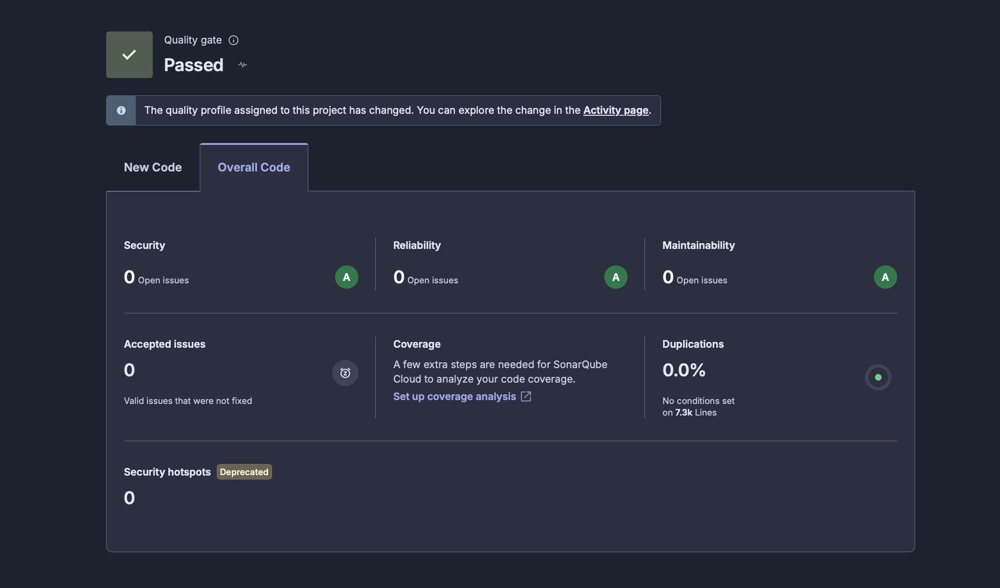

# Звіт SonarQube Cloud та рефакторинг (Лабораторна робота 8)

- **Проєкт:** [ukma-fin-ssdm-2026_ctrl-alt-defeat](https://sonarcloud.io/project/overview?id=ukma-fin-ssdm-2026_ctrl-alt-defeat) (автоматичний аналіз SonarQube Cloud)
- **Стан «до»:** аналіз коміту `4b5774b` гілки `main` від 2026-11-04; цей коміт збережено в гілці `pre-refactor` (версія `0.1.0`).
- **Стан «після»:** аналіз коміту `165483e` гілки `main` від 2026-11-04 22:19 UTC, тобто після злиття всіх рефакторингів (PR #177, #179, #181; версія `0.1.1`, тег `v0.1.1`).
- **Quality Gate:** до — 🟢 Passed; після — 🟢 Passed.
- **Примітка про quality profile:** панель і «до», і «після» показує повідомлення про зміну quality profile. Історія аналізів (таблиця 1.1) показує, що метрики змінювалися лише в аналізах комітів наших PR, а між ними лишалися сталими. Тож уся різниця «до/після» — наслідок наших змін, а не зміни профілю.

## 1. Метрики

### 1.1. Обрані метрики (до / після)

Ці три метрики найкраще ілюструють стан коду. Maintainability та Reliability Rating уже мають оцінку **A**, тож покращувати їх нікуди. Технічний борг цілком складається із запахів супроводжуваності, а дублювання — єдиний вид запахів, якого автоматичний аналіз не зараховує в «Code Smells».

| Метрика | До | Після | Зміна |
|---|---|---|---|
| **Code Smells** (Maintainability open issues) | 4 | **0** | −4 (−100 %) |
| **Technical Debt** | 20 хв | **0 хв** | −20 хв |
| **Duplicated Lines (%)** | 0.5 % (2 блоки, 37 рядків) | **0.0 %** (0 блоків) | −0.5 п.п., за рахунок налаштування аналізу, не рефакторингу (див. 1.4) |

**Внесок кожного PR** (історія аналізів SonarQube Cloud, `main`):

| Коміт `main` | PR | Що змінилося | Code Smells | Tech Debt | Duplicated Lines | Accepted issues |
|---|---|---|---|---|---|---|
| `4b5774b` | — | стан «до» (`pre-refactor`, `v0.1.0`) | 4 | 20 хв | 0.5 % | 1 |
| `bd23fe7` | #177 | рефакторинги 1–2 (`Header.jsx`) + налаштування аналізу | 2 | 10 хв | 0.0 % | 1 |
| `c90a5e7` | #179 | рефакторинги 3–4 (`AuthModal.jsx`, `MovieCard.jsx`) | 0 | 0 хв | 0.0 % | 1 |
| `165483e` | #181 | рефакторинг 5 (S8544 у `ci.yml`) | 0 | 0 хв | 0.0 % | **0** |

Зміну Duplicated Lines слід читати разом з розділом 1.4: дублювання «до» знаходилось у тестах, які після налаштування `sonar.tests` не входять у продакшн-код. Тому воно зникло в тому самому аналізі `bd23fe7`, разом зі зміною налаштувань.

Довідково (не обрані для покращення):

| | До | Після |
|---|---|---|
| Maintainability Rating | A (4 open issues) | A (0 open issues) |
| Reliability Rating | A (4 open issues, ті самі S6848, що мають і вплив на надійність) | A (0 open issues) |
| Рядки коду (ncloc) | 12 167 (разом із тестами та OpenAPI) | 6 255 (лише продакшн-код після всіх рефакторингів, аналіз `165483e`; одразу після зміни налаштувань у `bd23fe7` — 6 242, див. 1.4) |
| Сумарна Cognitive Complexity | 967 | 939 |
| Попередження аналізу | 2 | 0 |

### 1.2. Security Rating (обов'язковий показник)

| | До | Після |
|---|---|---|
| **Security Rating** | **A**: 0 open issues, 0 Security Hotspots, 1 *Accepted issue* | **A**: 0 open issues, 0 Security Hotspots, **0** Accepted issues |

**Чому A.** Єдине security-issue — `githubactions:S8544` «Using dependencies without locking resolved versions» у `.github/workflows/ci.yml:25`, де CI встановлював залежності з `requirements.txt` без хешів. Раніше його позначили як *Accepted* (прийнятий ризик), тому панель показувала Security «0 open issues» і окремо «Accepted issues: 1», а рейтинг воно не знижувало. Вразливостей не було. Решту security-issue за останні 30 днів закрито (панель показує «6 closed»): CSRF і API traversal у `App.jsx`/`MovieDetails.jsx`, захардкоджений пароль у `seed_movies.py`, закріплення GitHub Action за SHA у `deploy-docs.yml`.

**Виправлення (І. Ліфєнцєв).** Прийнятий ризик S8544 закрито: у CI встановлення залежностей переведено на `requirements-lock.txt` із прапорцем `--require-hashes --only-binary :all:`, точно як у Docker-образі (точні версії та sha256-хеші всіх пакетів). Тепер цілісність залежностей гарантується криптографічними хешами, а статус «після» становить 0 open issues та 0 accepted issues.

Рейтинг **A** продовжує лінію Лаб 3 (модель загроз STRIDE) та Лаб 5 (bandit/SAST). Ось що його підтримує:
- секрети тільки в змінних оточення та налаштуваннях хостингу, паролів і JWT-ключа в коді немає;
- `gitleaks` сканує всю історію в CI, `bandit -ll` перевіряє бекенд;
- завантаження в CI закріплені за HTTPS і контрольною сумою, Docker-образ встановлює залежності з хешами (`requirements-lock.txt`);
- запити зі змінюваними даними мають сталі URL, ідентифікатори передаються в тілі чи параметрах (правило CSRF від Sonar).

### 1.3. Скриншоти панелі аналізу

| До (аналіз `4b5774b`, 2026-11-04) | Після (аналіз `165483e`, 2026-11-04) |
|---|---|
|  |  |

### 1.4. Налаштування аналізу (`.sonarcloud.properties`)

Аналіз «до» мав два попередження:
1. *«Your code is analyzed as compatible with Python versions 3.10 through 3.14…»* Задано `sonar.python.version=3.11`, версію CI та Docker-образу.
2. *«SonarPython detected files that look like test code but 'sonar.tests' is not configured…»* Задано `sonar.tests`: тести (`tests/**`, `frontend/src/**/*.test.js(x)`) тепер аналізуються як тестовий код, а не як продакшн-код.

Крім того, з аналізу виключено згенеровані файли: звіт покриття (`htmlcov/`, `coverage/`), збірку фронтенду (`frontend/dist/`), специфікацію `docs/api/openapi-generated.yaml` (близько 2,5 тис. рядків) і `requirements-lock.txt`.

**Вплив на стовпець «після» (підтверджено аналізом `bd23fe7`).** Обидва попередження зникли (0 warnings). Кількість рядків коду зменшилась з 12 167 до 6 242 (у наступних аналізах, після PR #179 і #181, додалося ще 13 рядків, тож у підсумковому стовпці таблиці 1.1 — 6 255): тести бекенду (близько 2,5 тис.), тести фронтенду (близько 1 тис.) і OpenAPI (близько 2,5 тис.) більше не рахуються як продакшн-код. **Duplicated Lines** рахується по продакшн-коду, а єдине дублювання «до» (2 блоки, 37 рядків) знаходилось у тестах (`tests/test_auth.py` / `tests/test_movies.py`). Тому вона стала 0 % через налаштування, а не через рефакторинг. Ці зміни налаштувань відокремлено від рефакторингів у таблиці 1.1 і в CHANGELOG (`### Changed`).

## 2. Знахідки SonarQube Cloud (стан «до»)

| # | Правило | Файл:рядок | Вплив | Борг | Хто виправляє |
|---|---|---|---|---|---|
| 1 | S6848 «Avoid non-native interactive elements» | `frontend/src/components/Header.jsx:71` (логотип) | Maintainability Low, Reliability Medium | 5 хв | М. Крилов — рефакторинг 1 |
| 2 | S6848 | `frontend/src/components/Header.jsx:101` (підказки пошуку) | Maintainability Low, Reliability Medium | 5 хв | М. Крилов — рефакторинг 2 |
| 3 | S6848 | `frontend/src/components/AuthModal.jsx:216` (перемикач «Створити / Увійти») | Maintainability Low, Reliability Medium | 5 хв | Ю. Галка — рефакторинг 3 |
| 4 | S6848 | `frontend/src/components/MovieCard.jsx:22` (картка фільму) | Maintainability Low, Reliability Medium | 5 хв | Ю. Галка — рефакторинг 4 |
| 5 | githubactions:S8544 «Using dependencies without locking resolved versions» | `.github/workflows/ci.yml:25` (встановлення залежностей у CI) | Security Medium (Accepted) | 1 год | І. Ліфєнцєв — рефакторинг 5 |

Окрім чотирьох запахів коду, панель показувала п'яте issue: `githubactions:S8544` у `.github/workflows/ci.yml:25` (Security Medium, статус *Accepted*). Його виправлено в рефакторингу 5 (див. 1.2 та 3.5).

Додаткові кандидати, яких панель не зараховує в Code Smells:
- **Дублювання:** однакова підготовка тестової БД і клієнта (37 рядків) у `tests/test_auth.py:19` та `tests/test_movies.py:14`. Після налаштування `sonar.tests` це тестовий код, тож панель його вже не покаже; винесення фікстур у `tests/conftest.py` (*Extract Function* / *Pull Up*) лишається корисним рефакторингом, але його ефект треба доводити тестами, а не цією метрикою.
- **Cognitive Complexity:** найскладніший файл `frontend/src/pages/MovieDetails.jsx` (215), далі `UserProfile.jsx` (92) і `AuthModal.jsx` (86).

## 3. Рефакторинги

### Рефакторинг 1. Логотип у шапці → нативна кнопка (М. Крилов)

- **Запах:** S6848, нестандартний інтерактивний елемент. Логотип був `
`: на нього не можна перейти клавішею Tab і не можна натиснути Enter, а екранні диктори не оголошують його як кнопку.
- **Техніка:** *Substitute Algorithm*, тобто реалізацію «div + обробник кліку» замінено на нативний елемент `<button type="button">` з тим самим обробником і класами.
- **Що лишається незмінним:** клік по логотипу викликає `onGoHome` один раз, вигляд шапки той самий.
- **Що змінюється в структурі:** тип елемента. Тепер він доступний із клавіатури та має роль `button` з доступним ім'ям «Після титрів» (з `alt` логотипа).
- **Тести:** `Header.test.jsx`. Тест поведінки `goes to the home page from the logo` написано **до** зміни, і він проходить і до, і після. Тест `the logo is a button reachable with the keyboard` на коді «до» падав, а після зміни проходить.

### Рефакторинг 2. Підказки пошуку → нативні кнопки + окрема функція вибору (М. Крилов, з ШІ-агентом)

- **Запах:** S6848, той самий нестандартний інтерактивний елемент. Кожна підказка була `
` з вбудованим анонімним обробником на три дії.
- **Техніки:** *Extract Function*: три дії (відкрити фільм, очистити пошук, закрити список) винесено у функцію `selectSuggestion(movie)`. *Substitute Algorithm*: `
` замінено на `<button type="button">`, а вкладені `
/<h4>/
` — на ``, бо всередині кнопки HTML дозволяє лише рядкові елементи.
- **Що лишається незмінним:** вибір підказки викликає `onSelectMovie(movie)`, очищає поле пошуку й закриває список. Вигляд списку той самий.
- **Що змінюється в структурі:** обробник став іменованою функцією, кожна підказка стала кнопкою, доступною з клавіатури.
- **Тести:** `Header.test.jsx`. Тест поведінки `opens a movie from the search suggestions and clears the search` написано **до** зміни, він проходить до і після. Тест `each search suggestion is a button reachable with the keyboard` на коді «до» падав, а після зміни проходить.
- **Візуальна перевірка:** скриншоти шапки з відкритими підказками, зроблені до і після рефакторингу (Playwright, однаковий розмір вікна), **збігаються до пікселя**.

### Рефакторинг 3. Перемикач авторизації → нативна кнопка (Ю. Галка, з ШІ-агентом)

- **Запах:** S6848, використання неінтерактивного HTML-елемента для виконання дії. У `AuthModal.jsx` перемикач між авторизацією та реєстрацією був реалізований через ``. Такий елемент не підтримує стандартну клавіатурну взаємодію та не має семантики кнопки.
- **Техніка:** *Substitute Algorithm* (каталог рефакторингів М. Фаулера), як і в рефакторингах 1–2: реалізацію «`` + обробник кліку» замінено на нативний елемент `<button type="button">` з тим самим обробником `onClick` і CSS-класами.
- **Що лишається незмінним:** перемикання між формами входу та реєстрації, очищення повідомлень про помилки (`setError('')`) та інформаційних повідомлень (`setSuccessInfo(null)`), зовнішній вигляд перемикача.
- **Що змінюється в структурі:** замість текстового елемента використовується нативна HTML-кнопка. Вона підтримує навігацію через Tab та активацію клавішами Enter і Space. Атрибут `type="button"` запобігає випадковому відправленню форми.
- **Тест, що це доводить:** `AuthModal.test.jsx`, тест `switches between login and registration using an accessible button`. Перевіряє наявність кнопки, її тип, доступність для фокусування та перемикання між формами. Усі 6 тестів `AuthModal` пройдено.
- **Коміт:** `af035dc` — `refactor: improve AuthModal accessibility and add regression test`.

### Рефакторинг 4. Інтерактивна картка фільму → окремі нативні кнопки (Ю. Галка, з ШІ-агентом)

- **Запах:** S6848, використання `
` для відкриття деталей фільму. Зовнішній контейнер `MovieCard.jsx` виконував роль кнопки, але не підтримував стандартну клавіатурну взаємодію. Усередині також була кнопка Watchlist, що ускладнювало правильну семантичну структуру.
- **Техніка:** *Substitute Algorithm* (каталог рефакторингів М. Фаулера), як і в рефакторингах 1–3: реалізацію «`
` + обробник кліку» замінено на нативний `<button type="button">`, який містить зображення та інформацію про фільм. Кнопка Watchlist тепер не вкладена в клікабельний контейнер, а стоїть поруч як незалежний елемент, тому `e.stopPropagation()` у її обробнику більше не потрібен.
- **Що лишається незмінним:**
  - Натискання на картку відкриває деталі вибраного фільму через `onSelect(movie)`.
  - Натискання Watchlist викликає `onToggleWatchlist(movie.id || movie.content_id)`.
  - Натискання Watchlist не відкриває деталі фільму.
  - Збережено відображення назви, зображення, категорії, рейтингу, року та жанру.
  - Збережено стилі Tailwind CSS та анімації.
- **Що змінюється в структурі:** зовнішній `
` став звичайним контейнером. Усередині розміщено дві незалежні кнопки без вкладення одна в одну. Обидві підтримують стандартну клавіатурну взаємодію.
- **Тести, що це доводять:** `MovieCard.test.jsx`:
  1. `opens movie details when the card button is clicked` — перевіряє відкриття фільму.
  2. `toggles watchlist without opening movie details` — перевіряє незалежність Watchlist.
  3. `uses native buttons for both interactive actions` — перевіряє використання двох нативних кнопок.

  Усі 3 нові тести пройдено. Також успішно пройшли 9 тестів `Recommendations.test.jsx`, зокрема перевірка відкриття фільму за натисканням на назву.

### Рефакторинг 5. Закріплення залежностей CI за sha256-хешами (І. Ліфєнцєв, з ШІ-агентом)

- **Запах / Security-ризик:** `githubactions:S8544`, використання залежностей без фіксації розв'язаних версій і хешів. У `.github/workflows/ci.yml:25` крок називався `Install locked dependencies`, проте фактично викликав `python -m pip install --only-binary :all: -r requirements.txt`. Це створювало ризик supply-chain attacks (підміна транзитивних бібліотек у репозиторії PyPI) і вимагало тимчасового прийняття ризику («Accepted issue») у SonarQube Cloud.
- **Техніка:** *Pin Dependencies with Hashes* / *Enforce Dependency Integrity Verification* (каталог безпекових рефакторингів). Встановлення переведено на `requirements-lock.txt` із прапорцем `--require-hashes --only-binary :all:`, що синхронізує поведінку CI із продакшн `Dockerfile`.
- **Що лишається незмінним:** набір пакетів і їх точні версії, які встановлюються для бекенду в CI; поведінка всіх тестів, лінтерів і генераторів коду в конвеєрі GitHub Actions на `ubuntu-latest` (Python 3.11).
- **Що змінюється в структурі:** рядок виклику pip у конвеєрі тепер читає `requirements-lock.txt` і суворо верифікує контрольні sha256-суми кожного колеса (wheel/sdist).
- **Тест, що це доводить:** `tests/test_workflows_security.py`, новий тест `test_ci_workflow_installs_dependencies_with_hashes`. До рефакторингу тест падав із помилкою `AssertionError: CI should install dependencies from requirements-lock.txt`, після зміни — успішно проходить. Синхронізація версій між `requirements.txt` і `requirements-lock.txt` додатково гарантується скриптом `scripts/check_requirements_lock.py`.
- **Коміт:** з позначкою `[REFACTOR]`.

## 4. Використання ШІ

- **Що виконано з агентом:** рефакторинги 1–2 (М. Крилов). Використовувався кодовий агент Claude. У завданні агенту були запах (S6848 у `Header.jsx:71` і `:101`), техніки (заміна на нативну кнопку, Extract Function) і те, що має лишитися незмінним: обробники, очищення пошуку, вигляд.
- **Що згенеровано:** зміни в `Header.jsx` (дві кнопки, функція `selectSuggestion`, заміна блочних елементів усередині кнопки) і чотири тести в `Header.test.jsx`.
- **Як верифіковано:**
  1. Спершу написано тести поведінки, і вони пройшли на старому коді. Потім тести доступності, які на старому коді впали, як і очікувалось.
  2. Зміни в diff переглянуто рядок за рядком перед застосуванням. Агент сам виправив `<h4>/
` усередині кнопки на ``, бо це невалідний HTML, і це теж переглянуто.
  3. Пройшли регресійні тести (розділ 5), eslint і збирання Vite.
  4. Скриншоти до і після збігаються до пікселя.
  5. Метрика після злиття: в аналізі `bd23fe7` (PR #177) обидва issue S6848 в `Header.jsx` зникли, Code Smells 4 → 2, технічний борг 20 → 10 хв.

- **Що виконано з допомогою ШІ:** рефакторинги 3–4 (Ю. Галка) `AuthModal.jsx` та `MovieCard.jsx`, спрямовані на усунення проблем SonarQube Cloud S6848.
- **Що згенеровано:**
  - Заміна `` на `<button type="button">` у `AuthModal.jsx`.
  - Перебудова структури `MovieCard.jsx` із використанням двох незалежних нативних кнопок.
  - Регресійний тест для `AuthModal.test.jsx`.
  - Три регресійні тести для `MovieCard.test.jsx`.
  - Документація виконаних рефакторингів.

- **Як верифіковано:**
  1. Переглянуто запропоновані зміни та перевірено збереження обробників подій.
  2. Запущено регресійні тести `AuthModal.test.jsx`: 6/6 passed.
  3. Запущено регресійні тести `MovieCard.test.jsx`: 3/3 passed.
  4. Після першого варіанта рефакторингу `MovieCard.jsx` виявлено падіння тесту `Recommendations.test.jsx`, оскільки натискання на назву фільму більше не викликало `onSelect`.
  5. Структуру компонента скориговано: назву та інформацію про фільм перенесено всередину нативної кнопки.
  6. Повторно запущено повний набір тестів фронтенду: 121/121 passed, 15 test files passed.
  7. Метрика після злиття: в аналізі `c90a5e7` (PR #179) зникли обидва S6848 в `AuthModal.jsx` і `MovieCard.jsx`, Code Smells 2 → 0, технічний борг 10 → 0 хв.

- **Результат:** обидва компоненти використовують семантично правильні інтерактивні HTML-елементи. Наявні регресійні тести не виявили змін функціональної поведінки.

- **Що виконано з допомогою ШІ:** рефакторинг 5 (І. Ліфєнцєв) `.github/workflows/ci.yml` та розширення тестів безпеки `test_workflows_security.py` для усунення SonarQube Cloud issue `githubactions:S8544`.
- **Що згенеровано:**
  - Тест безпеки конфігурації workflow `test_ci_workflow_installs_dependencies_with_hashes` у `tests/test_workflows_security.py`.
  - Зміна команди інсталяції в `.github/workflows/ci.yml` на безпечну з `--require-hashes` та `requirements-lock.txt`.
  - Документація рефакторингу та оновлення `CHANGELOG.md`.
- **Як верифіковано:**
  1. Спершу написано тест безпеки конфігурації у `tests/test_workflows_security.py`: запущено pytest і переконанося, що на коді «до» тест падає (червоний статус, `AssertionError: CI should install dependencies from requirements-lock.txt`).
  2. Внесено зміну в `.github/workflows/ci.yml` та повторно запущено тест: він став зеленим (5/5 passed).
  3. Перевірено синхронізацію файлів блокування: `python scripts/check_requirements_lock.py` повернув 0.
  4. Запущено повний набір бекенд-тестів: 284 passed, покриття коду `src.api` 98 %.
  5. Перевірено лінтери та SAST: `ruff check` (OK), `bandit -ll` (0 вразливостей), `scripts/verify_traceability.py` (32/32 PASSED).
  6. Перевірено тести фронтенду: `npm --prefix frontend test -- --run` (121/121 passed).
  7. Здійснено построковий перегляд diff перед створенням коміту.
- **Результат:** ризик ненадійної фіксації залежностей повністю закрито, статус Accepted знято, CI суворо перевіряє sha256-хеші аналогічно до Docker-образу.

## 5. Регресійне тестування

| Набір | Команда | До | Після рефакторингів 1–2 | Після рефакторингів 3–4 | Після рефакторингу 5 |
|---|---|---|---|---|---|
| Бекенд (pytest, покриття ≥ 80 %) | `pytest --cov=src.api tests/` | 276 passed, 98 % | 279 passed, 98 % | 283 passed, 98 % | 284 passed, 98 % |
| Фронтенд (Vitest) | `npm --prefix frontend test` | 113 passed | 117 passed | 121 passed | 121 passed |
| Лінтери | `ruff`, `black --check`, `eslint`, `bandit -ll` | OK | OK | OK | OK |
| Простежуваність | `python3 scripts/verify_traceability.py` | PASSED | PASSED | PASSED | PASSED |

Остаточних збоїв не було. Тести, які на коді «до» падали, — це нові тести доступності та безпеки конфігурації; вони й мали падати до рефакторингу (розділ 3). Один проміжний збій під час рефакторингу 4 (`Recommendations.test.jsx`: клік по назві фільму перестав відкривати деталі) виявлено регресійним прогоном і виправлено до злиття (розділ 4). CI (`build`, `frontend`, `secrets`, `docker`) зелений на всіх трьох PR.

## 6. Реліз

- **Версія:** `0.1.0` → `0.1.1` (patch: чистий рефакторинг без зміни поведінки).
- **Де записано:** `pyproject.toml`, `frontend/package.json` (і `package-lock.json`), `CHANGELOG.md` (розділ `## [0.1.1] - 2026-11-05`, категорії `### Refactoring` і `### Changed`), git-тег `v0.1.1` на `main`. Тест `tests/test_release_version.py` перевіряє, що номер збігається скрізь.
- **Коміти:** з позначкою `[REFACTOR]` (PR #177, #179, #181).
- **Стан «до»:** гілка `pre-refactor` і тег `v0.1.0` (`4b5774b`); порівняння: [v0.1.0...v0.1.1](https://github.com/ukma-fin-ssdm-2026/ctrl-alt-defeat/compare/v0.1.0...v0.1.1).
